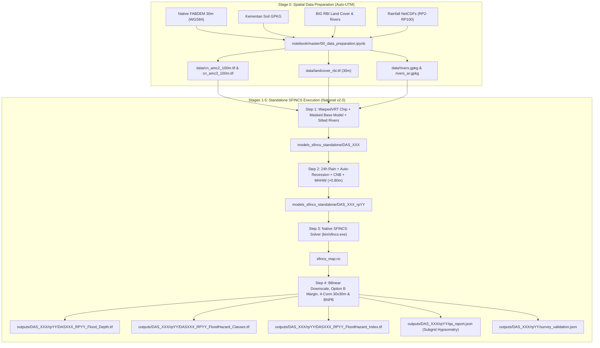

# HydroMT-SFINCS Standalone 2D Flood Hazard Pipeline
### 17 Clustered DAS, Sumatera Barat — Direct Rainfall-on-Grid 2D Hydrodynamic Modeling

Referenced against official Deltares documentation and verified peer-reviewed literature:
- HydroMT-SFINCS Plugin: https://deltares.github.io/hydromt_sfincs/latest/
- SFINCS Model Documentation: https://sfincs.readthedocs.io/en/latest/
- HydroMT Core: https://deltares.github.io/hydromt/latest/
- SFINCS Formulation & Global Validation: Leijnse et al. (2021); Eilander et al. (2023); Sadana et al. (2026)

---

## 1. Executive Summary & Modeling Strategy

This repository implements a **Standalone 2D Hydrodynamic Flood Hazard Modeling Pipeline** using **Deltares SFINCS** (*Super-Fast INundation of CoastS*, v2.4.0 Galibier Release) via **HydroMT `0.10.1`** and **`hydromt-sfincs 1.2.2`** across all **17 clustered watershed basins** (`DAS_101` to `DAS_114`, with Mentawai disaggregated into `DAS_108_A`–`D`) in Sumatera Barat, Indonesia.

### Core Modeling Principles (National Indonesian *Kabupaten* v2.0 Standard):
1. **Indonesian Auto-UTM & National Portability**:
   Automatically detects the appropriate WGS 84 UTM zone across all of Indonesia (`EPSG:32646–32654` North / `EPSG:32746–32754` South via `scripts/geo_utils.py`) and standardizes BIG RBI land-cover parameterization via the canonical 15-class national table (`lookup_tables/national_rbi_lookup.csv`).
2. **Dynamic-Recession Direct Rainfall-on-Grid (Unified Pluvial–Fluvial Routing)**:
   SFINCS applies 24-hour design storm hyetographs directly onto active computational cells, padded with explicit zero-intensity recession hours scaled dynamically by catchment area (`24 h` for `< 500 km²`, `36 h` for `500–1,500 km²`, `48 h` for `> 1,500 km²`), with optional USWB/WMO Areal Reduction Factor (`apply_arf=False` by default) and safe numerical tuning (`alpha=0.65`, `huthresh=0.02`, `viscosity=0`).
3. **Strict Active Watershed Masking & Coastal MHHW / Outflow Boundaries**:
   Active cells are strictly masked to the hydrological catchment polygon (`mask: das_region`, `reset_mask: true`) so open ocean and neighboring catchments remain inactive (`msk=0`), cutting active cell counts by 40%–70%. Coastal waterlevel cells (`msk=2`, $z \le 0$) receive **Mean Higher High Water (MHHW `+0.80 m`)** tidal backwater via native `sfincs.bnd`/`sfincs.bzs`, paired with inland outflow boundaries (`msk=3`) snapped to lowest-elevation outlets.
4. **Subgrid Topography, On-the-Fly DEM Chipping & Pre-Field River Burning**:
   Defaults to the **80 m flux mesh / 10 m subgrid** (`configs/sfincs_standalone_build_80m_fast.yml`, `nr_subgrid_pixels: 8`, ~13× faster solver), with an optional **40 m flux mesh / 10 m subgrid** high-resolution mode (`configs/sfincs_standalone_build.yml`, `nr_subgrid_pixels: 4`). Per-DAS elevation chips are extracted and bilinearly reprojected on-the-fly via GDAL `WarpedVRT` directly from native **30 m bare-earth FABDEM** (`data_raw/fabdem/FABDEM30m_Sumbar.tif`). River centerlines enhanced with BIG RBI polygon widths (`data/rivers_ar.gpkg`) are burned using vegetated/aggraded Indonesian channel roughness ($n = 0.045$, Chow 1959 / Triatmodjo 2008) and pre-field fallback geometry ($w = 8/15/22\text{ m}$, $d = 0.35/0.55/0.80\text{ m}$, replaceable with BWS cross-section surveys).
5. **Modern USDA-NRCS Curve Number Infiltration (`CNB`, Single-Counted AMC)**:
   Uses SFINCS `v2.4.0+` Curve Number with Recovery (`smaxfile`, `sefffile`, `ksfile` in meters) derived from **Kementan Soil HSG × BIG RBI Land Cover** (`scripts/generate_cn_raster.py`, single-counted `AMC-II` for `RP2–RP10` and `AMC-III` via `cn2_to_cn3` for `RP25–RP100` with `initial_sat_frac=0.0`, `seff = S_max`, strictly avoiding AMC double-counting per **USDA-NRCS NEH Part 630**, **SNI 2415:2016**, and Deltares SFINCS), avoiding the broken legacy `scsfile` binary path in SFINCS `v2.4.0` (with constant-loss `data/soil_infiltration_100m.tif` retained as an explicit fallback).
6. **Strict Hydrostatic Post-Processing (15 cm Floor), Subgrid QA & BNPB Standards**:
   Downscales water surface elevations ($z_s$) bilinearly onto 10 m subgrid topography, strictly removes all pixels below **`MIN_FLOOD_DEPTH_M = 0.15 m` (15 cm)** across Depth, FHI, and Classes rasters (Wing et al., 2018; Sampson et al., 2015; Bates et al., 2021), repairs coarse-cell bilinear edge-NaN dropouts purely where true simulated $z_s - z_{\text{DEM}} \ge 0.15\text{ m}$ (`freeboard_m = 0.0`, `max_ext_dist_m = 80.0 m = 1.0 × dx`, zero synthetic water inflation; Neal et al., 2012; Schumann et al., 2014), protects mapped RBI river channels during steep-slope pruning ($\ge 8^\circ$, Van Zuidam, 1985), applies **road/bund bridging (`bridge_radius = 3` / `30 m`)**, **4-connected `30 m × 30 m` (`0.09 ha`) native FABDEM floor** (`island_mmu_ha=0.09`, `min_hole_ha=0.09`), `1.0 ha` hydrostatically submerged void limit (`2 mm × 2 mm` @ 1:50,000; $\sigma = 1.0\text{ px}$; **SNI 6502.3:2010** & **Peraturan BIG No. 18/2021**), verifies mass conservation via **exact subgrid hypsometric storage curves** (`sfincs_subgrid.nc`), and classifies hazard tiers per **Perka BNPB No. 02/2012** alongside a continuous Fuzzy Large FHI surrogate and outlier-screened QField validation.

---

## 2. Theoretical Formulation & Governing Equations

SFINCS solves the 2D depth-averaged simplified shallow water equations (local inertial / diffusive wave approximation) coupled with subgrid elevation-volume and roughness integration (Leijnse et al., 2021; Volp et al., 2013).

### 2.1 Continuity Equation (Conservation of Mass)
$$\frac{\partial \eta}{\partial t} + \frac{\partial (h u)}{\partial x} + \frac{\partial (h v)}{\partial y} = P - q_{\text{inf}}$$

Where:
* $\eta(x, y, t)$: Water surface elevation above datum (m).
* $h(x, y, t) = \eta - z_b$: Local water depth (m), where $z_b$ is bed elevation.
* $u, v$: Depth-averaged flow velocities in $x$ and $y$ directions (m/s).
* $P(x, y, t)$: Direct precipitation rate from the 24-hour design hyetograph (m/s).
* $q_{\text{inf}}(x, y)$: Spatially distributed soil infiltration rate (m/s).

### 2.2 Momentum Balance (Surface Friction & Gravity)
Under the simplified subgrid shallow-water formulation (with local inertia controlled by `alpha` and bed friction governed by distributed Manning's $n$):
$$u = \frac{R^{2/3}}{n \sqrt{|\nabla \eta|}} \left(-\frac{\partial \eta}{\partial x}\right), \qquad v = \frac{R^{2/3}}{n \sqrt{|\nabla \eta|}} \left(-\frac{\partial \eta}{\partial y}\right)$$

Where $R$ is the subgrid hydraulic radius and $n$ is the distributed Manning roughness coefficient mapped from BIG RBI Land Cover (`lookup_tables/manning_lookup.csv`).

---

## 3. Physical Soil Infiltration Parameterization

### 3.1 Primary v2.0 Standard: USDA-NRCS Curve Number with Recovery (`CNB`)
By default (`infiltration_mode="cnb"`), the v2.0 pipeline uses SFINCS `v2.4.0+` **Curve Number with Recovery (`smaxfile`, `sefffile`, `ksfile`)** in meters derived by `scripts/generate_cn_raster.py` from **Kementan Soil Texture (HSG A–D) × Canonical BIG RBI Land Cover (`lookup_tables/national_rbi_lookup.csv`)**:
* **Maximum Soil Moisture Retention**: $S_{\max} = \left(\frac{1000}{\text{CN}} - 10\right) \times 0.0254\text{ m}$
* **Return-Period Antecedent Moisture (Single-Counted per USDA-NRCS NEH Part 630 & SNI 2415:2016)**:
  - Frequent storms (`RP2`–`RP10`): `data/cn_amc2_100m.tif` (`AMC-II` average condition, `initial_sat_frac = 0.0` → `seff = S_max(AMC-II)`)
  - Extreme monsoon storms (`RP25`–`RP100`): `data/cn_amc3_100m.tif` (`AMC-III` wet condition via `cn2_to_cn3`, `initial_sat_frac = 0.0` → `seff = S_max(AMC-III)`, avoiding AMC double-counting!)
* **Critical Solver Guard**: Legacy `scsfile` (`cna`) is explicitly prohibited and stripped from `sfincs.inp` because `SFINCS v2.4.0 Galibier` exhibits a zero-runoff solver defect under legacy binary `scsfile` + `netamprfile`.

### 3.2 Fallback Option: Pre-Saturated AMC-III Constant-Loss Matrix (`qinf`)
When `infiltration_mode="qinf"` (or if CN rasters are absent), the pipeline falls back to the pre-calibrated AMC-III constant-loss matrix (`lookup_tables/soil_infiltration_lookup.csv`, `amc_scale=1.0` — no double scaling) reflecting saturated wet-monsoon soils (USDA-NRCS, 2004; Arsyad, 2010; Triatmodjo, 2008):

| Kementan Soil Texture | Paddy (Sawah) | Urban (Permukiman) | Dryland Farm (Tegalan) | Plantation (Perkebunan) | Forest (Hutan) | Shrub (Semak Belukar) | Default |
| :--- | :---: | :---: | :---: | :---: | :---: | :---: | :---: |
| **Halus (Clay)** | `0.025` | `0.005` | `0.090` | `0.110` | `0.225` | `0.130` | `0.090` |
| **Agak Halus (Clay Loam)** | `0.025` | `0.005` | `0.170` | `0.150` | `0.340` | `0.190` | `0.150` |
| **Sedang (Loam)** | `0.025` | `0.005` | `0.280` | `0.225` | `0.550` | `0.300` | `0.260` |
| **Agak Kasar (Sandy Loam)** | `0.025` | `0.005` | `0.450` | `0.375` | `0.825` | `0.525` | `0.450` |
| **Kasar (Sand)** | `0.025` | `0.005` | `0.750` | `0.550` | `1.300` | `0.825` | `0.750` |
| **Gambut (Peat)** | `0.025` | `0.005` | `0.075` | `0.090` | `0.110` | `0.090` | `0.075–0.110` |
| **Badan Air (Water)** | `0.000` | `0.000` | `0.000` | `0.000` | `0.000` | `0.000` | `0.000` |

*(Units: $\text{mm/hr}$. Note: For future v3.0 migration to **HydroMT-SFINCS v2.0+ / SFINCS v2.5.0 Hautacam**, these binary `CNB` maps migrate cleanly to NetCDF `inffile` with `inftype = cnb` alongside native Quadtree adaptive refinement.)*

---

## 4. End-to-End Pipeline Architecture



---

## 5. BNPB Disaster Hazard Classification & Post-Processing Standard

Flood hazard classification follows **Peraturan Kepala BNPB No. 02 Tahun 2012 (Pedoman Umum Pengkajian Risiko Bencana)**:

### 5.1 Depth Threshold Matrix
* **Minimum Hazard Cutoff (`MIN_FLOOD_DEPTH_M` / `hmin`)**: $0.15\text{ m}$ (`15 cm`; pixels `< 0.15 m` are strictly excluded as `NaN` / Class `0` across Depth, FHI, and Classes rasters to filter shallow overland sheet-flow and DEM noise; Wing et al., 2018; Sampson et al., 2015; Bates et al., 2021)
* **Rendah (Low Hazard / Class 1)**: $0.15\text{ m} \le h < 0.76\text{ m}$ (Green `#34A853`)
* **Sedang (Medium Hazard / Class 2)**: $0.76\text{ m} \le h \le 1.50\text{ m}$ (Amber `#FBBC05`)
* **Tinggi (High Hazard / Class 3)**: $h > 1.50\text{ m}$ (Red `#EA4335`)

### 5.2 Continuous Flood Hazard Index Surrogate (Fuzzy Large Membership)
To complement the statutory discrete Perka BNPB No. 02/2012 tiers (`0.333`, `0.667`, `1.000`), a continuous sigmoidal surrogate (Klir & Yuan, 1995) calibrated to the `0.76 m` and `1.50 m` BNPB depth thresholds is also generated (`NaN` for $h < 0.15\text{ m}$):
$$\text{FHI}(h) = \frac{1}{1 + \left(\frac{h}{x_0}\right)^{-s}}, \quad x_0 = 1.125\text{ m},\; s = 1.75$$

### 5.3 Strict Hydrostatic Post-Processing (15 cm Floor), Anti-Aliasing & 4-Connected `30 m × 30 m` Floor
To eliminate sub-sensor discretization artifacts and bilinear edge-NaN dropouts **without inventing synthetic water volume**, the post-processing engine executes a 6-stage strictly hydrostatic filter:
1. **15 cm Hazard Cutoff & Steep Hillslope Pruning with RBI River Protection**: Strictly removes all pixels below `hmin = 0.15 m` (15 cm; Wing et al., 2018; Sampson et al., 2015; Bates et al., 2021) and prunes isolated 1-pixel steep hillside sheet-flow noise ($\ge 8^\circ$, Van Zuidam, 1985) while **always protecting mapped BIG RBI river corridors** (30 m buffer) so mountain flash-flood (*banjir bandang*) channels remain intact.
2. **Pure Bilinear Edge-NaN Recovery (`freeboard_m = 0.0`, `max_ext_dist_m = 80.0 m`)**: Extrapolates the smoothed simulated water surface ($z_s$) outward up to `1.0 × dx` (`80 m` on 80 m mesh; `40 m` on 40 m mesh) strictly to repair bilinear edge-NaN dropouts where true simulated $z_s - z_{\text{DEM}} \ge 0.15\text{ m}$ (Neal et al., 2012; Schumann et al., 2014). Deterministic `freeboard_m` is strictly **`0.0 m`** (zero invented water; DEM vertical error belongs exclusively in optional sensitivity envelopes).
3. **Hydro-morphological Bridging & Enclosed Hole-Filling**: Disk kernel (`bridge_radius=3`, 30 m radius matching Indonesian arterial roads/embankments `10–30 m` wide) bridges narrow road cuts/culverts and fills enclosed flat voids (`hole_mmu_ha=1.0`, `2 mm × 2 mm` legibility @ 1:50,000; **SNI 6502.3:2010** & **Peraturan BIG No. 18/2021**) **strictly where hydrostatically submerged** ($z_s - z_{\text{DEM}} \ge 0.15\text{ m}$; never clamping shallow depths upward!).
4. **Boundary Anti-Aliasing**: Euclidean signed-distance transform smoothing ($\sigma = 1.0\text{ px}$; Borgefors, 1986) removes jagged pixel staircases; any post-smoothed pixel falling `< 0.15 m` is strictly set to `NaN`.
5. **4-Connected `30 m × 30 m` (`0.09 ha`) Pinhole & Speck Cleanup**: Enforces a resolution-independent **1-FABDEM-pixel (`0.09 ha`) floor** (`island_mmu_ha=0.09`, `min_hole_ha=0.09`; Hawker et al., 2022) using 4-connectivity (rook neighbors) to eliminate 100% of sub-sensor pinholes and scattered diagonal edge specks in QGIS.
6. **Subgrid Hypsometric QA & Survey Validation**: Verifies mass balance directly from `sfincs_subgrid.nc` (`z_level`, `z_volmax`) in `scripts/qa_checks.py` and validates against outlier-screened QField observations (`hmin=0.15`, `max_valid_depth_m=8.0` in `scripts/validate_against_survey.py`).

---

## 6. Directory Layout & Data Artifacts

```text
sumbar_flood_hazard/
├── bin/                                      # Native Windows 64-bit SFINCS v2.4.0 Galibier & DLLs
├── configs/
│   ├── sfincs_standalone_build.yml           # Standard 40 m flux / 10 m subgrid (silted rivers)
│   └── sfincs_standalone_build_80m_fast.yml  # High-speed 80 m flux / 10 m subgrid
├── data_raw/                                 # Native source datasets (FABDEM30m_Sumbar.tif, RBI, Kementan)
├── data/                                     # Analysis-ready rasters & vectors (Auto-UTM; EPSG:32747 in Sumbar)
│   ├── cn_amc2_100m.tif & cn_amc3_100m.tif   # USDA-NRCS Curve Number rasters (AMC-II & AMC-III for CNB)
│   ├── soil_infiltration_100m.tif            # Kementan x RBI AMC-III constant-loss fallback (mm/hr)
│   ├── landcover_rbi.tif                     # BIG RBI integer land cover raster (30 m)
│   ├── rivers.gpkg & rivers_ar.gpkg          # BIG RBI river centerlines & river width polygons
│   ├── lake.gpkg                             # Permanent waterbody masks (excluded from flood hazard)
│   ├── das_clusters/sumbar_das_cluster.gpkg  # 17 watershed cluster boundaries
│   └── rainfall/                             # Hourly design storm NetCDFs (RP2–RP100)
├── lookup_tables/
│   ├── national_rbi_lookup.csv               # Canonical 15-class Indonesian BIG RBI Manning & CN table
│   ├── manning_lookup.csv                    # RBI integer class -> Manning's n
│   └── soil_infiltration_lookup.csv          # Soil texture x Land cover -> AMC-III qinf fallback
├── models_sfincs_standalone/                 # SFINCS base models & RP simulation runs
├── outputs/                                  # Final hazard deliverables (GeoTIFFs, QMLs & QA JSONs)
│   └── DAS_106/rp100/
│       ├── DAS106_RP100_Flood_Depth.tif
│       ├── DAS106_RP100_Flood_Depth_raw.tif
│       ├── DAS106_RP100_FloodHazard_Index.tif (+ .qml)
│       ├── DAS106_RP100_FloodHazard_Classes.tif (+ .qml)
│       ├── qa_report.json
│       └── survey_validation.json
├── scripts/                                  # Core Python engine, geo_utils, CN generator, QA & storage cleaner
├── tests/                                    # Automated pytest unit test suite (55 tests)
├── notebook/master/                          # 00_data_preparation.ipynb & 01_sfincs_flood_hazard_run.ipynb
├── data_catalog_sfincs.yml                   # HydroMT 0.10.1 / hydromt_sfincs 1.2.2 data catalog
├── pyproject.toml & uv.lock                  # Reproducible Python 3.12 dependency specification
└── docs/                                     # Engineering documentation
```

---

## 7. Python Execution Environment (`.venv` via `uv`)

The pipeline operates in a single reproducible Python 3.12 virtual environment managed by **`uv`**:

```powershell
uv sync --extra dev
.\.venv\Scripts\python.exe -m ipykernel install --user --name hydromt-sfincs --display-name "HydroMT-SFINCS"
.\.venv\Scripts\python.exe -m pytest
```

All C-libraries (`gdal`, `geos`, `proj`, `netcdf4`, `openmp`) are bundled natively without requiring Docker on Windows.

---

## 8. Verified Scientific & Regulatory References

1. **Leijnse, T., van Ormondt, M., Nederhoff, K., & van Dongeren, A. (2021).** *Modeling compound flooding in coastal systems using a computationally efficient reduced-physics solver: Including fluvial, pluvial, tidal, wind- and wave-driven processes.* **Coastal Engineering**, 163, 103796. [https://doi.org/10.1016/j.coastaleng.2020.103796](https://doi.org/10.1016/j.coastaleng.2020.103796)
2. **Eilander, D., Boisgontier, H., Bouaziz, L. J. E., Buitink, J., Couasnon, A., Dalmijn, B., Hegnauer, M., de Jong, T., Loos, S., Marth, I., & van Verseveld, W. (2023).** *HydroMT: Automated and reproducible model building and analysis.* **Journal of Open Source Software**, 8(83), 4897. [https://doi.org/10.21105/joss.04897](https://doi.org/10.21105/joss.04897)
3. **Eilander, D., Couasnon, A., Leijnse, T., Ikeuchi, H., Yamazaki, D., Muis, S., Dullaart, J., Haag, A., Winsemius, H. C., & Ward, P. J. (2023).** *A globally applicable framework for compound flood hazard modeling.* **Natural Hazards and Earth System Sciences**, 23(2), 823–846. [https://doi.org/10.5194/nhess-23-823-2023](https://doi.org/10.5194/nhess-23-823-2023)
4. **Sadana, T., Aerts, J. C. J. H., Eilander, D., Merz, B., de Moel, H., Busker, T., Bril, V. C., & de Bruijn, J. (2026).** *Validation of the open-source hydrodynamic model SFINCS on historical river floods at the global scale.* **Hydrology and Earth System Sciences**, 30(17), 5491–5519. [https://doi.org/10.5194/hess-30-5491-2026](https://doi.org/10.5194/hess-30-5491-2026)
5. **Volp, N. D., van Prooijen, B. C., & Stelling, G. S. (2013).** *A finite volume approach for shallow water flow accounting for high-resolution bathymetry and roughness data.* **Water Resources Research**, 49(7), 4126–4135. [https://doi.org/10.1002/wrcr.20315](https://doi.org/10.1002/wrcr.20315)
6. **Hawker, L., Uhe, P., Paulo, L., Sosa, J., Savage, J., Sampson, C., & Neal, J. (2022).** *A 30m global map of elevation with forests and buildings removed.* **Environmental Research Letters**, 17(2), 024016. [https://doi.org/10.1088/1748-9326/ac4d4f](https://doi.org/10.1088/1748-9326/ac4d4f)
7. **USDA Natural Resources Conservation Service (2004).** *National Engineering Handbook (NEH), Part 630: Hydrology, Chapter 10.* USDA-NRCS, Washington, D.C.
8. **Arsyad, S. (2010).** *Konservasi Tanah dan Air* (Edisi Kedua). IPB Press, Bogor; and **Triatmodjo, B. (2008).** *Hidrologi Terapan.* Beta Offset, Yogyakarta.
9. **Chow, V. T. (1959).** *Open-Channel Hydraulics.* McGraw-Hill, New York; and **Arcement, G. J., & Schneider, V. R. (1989).** *Guide for Selecting Manning's Roughness Coefficients for Natural Channels and Flood Plains.* USGS Water-Supply Paper 2339. [https://doi.org/10.3133/wsp2339](https://doi.org/10.3133/wsp2339)
10. **Soille, P. (2003).** *Morphological Image Analysis: Principles and Applications* (2nd ed.). Springer. [https://doi.org/10.1007/978-3-662-05088-0](https://doi.org/10.1007/978-3-662-05088-0); and **Borgefors, G. (1986).** *Distance transformations in digital images.* CVGIP, 34(3), 344–371. [https://doi.org/10.1016/S0734-189X(86)80047-0](https://doi.org/10.1016/S0734-189X(86)80047-0)
11. **Klir, G. J., & Yuan, B. (1995).** *Fuzzy Sets and Fuzzy Logic: Theory and Applications.* Prentice Hall, Upper Saddle River, NJ — *(Fuzzy Large continuous FHI surrogate calibrated to Perka BNPB thresholds)*.
12. **Wing, O. E. J., et al. (2018).** *Estimates of present and future flood risk in the conterminous United States.* **Environmental Research Letters**, 13(3), 034023; **Sampson, C. C., et al. (2015).** **Water Resources Research**, 51(9), 7358–7381; **Bates, P. D., et al. (2021).** **Water Resources Research**, 57(2), e2020WR028673 — *(Standard `0.15 m` [15 cm] minimum significant flood hazard cutoff)*.
13. **Neal, J., Schumann, G., & Bates, P. (2012).** **Water Resources Research**, 48(11), W11506; **Schumann, G. J.-P., et al. (2014).** **Journal of Hydrology**, 508, 289–298; **Van Zuidam, R. A. (1985).** *Terrain Analysis and Geomorphologic Mapping* (`>= 8°` hillslope threshold).
14. **Peraturan Kepala BNPB No. 02 Tahun 2012** (*Pedoman Umum Pengkajian Risiko Bencana*), **Permen PUPR No. 12/PRT/M/2014** (*Sistem Drainase Perkotaan*), **SNI 2415:2016** (*Tata Cara Perhitungan Debit Banjir Rencana*), **SNI 2830:2008**, **SNI 6502.3:2010** (*Peta Rupabumi Skala 1:50.000*), **Peraturan BIG No. 18 Tahun 2021**, and **Pushidrosal TNI AL / BIG SRGI** (*Daftar Pasang Surut Teluk Bayur, Padang*).
