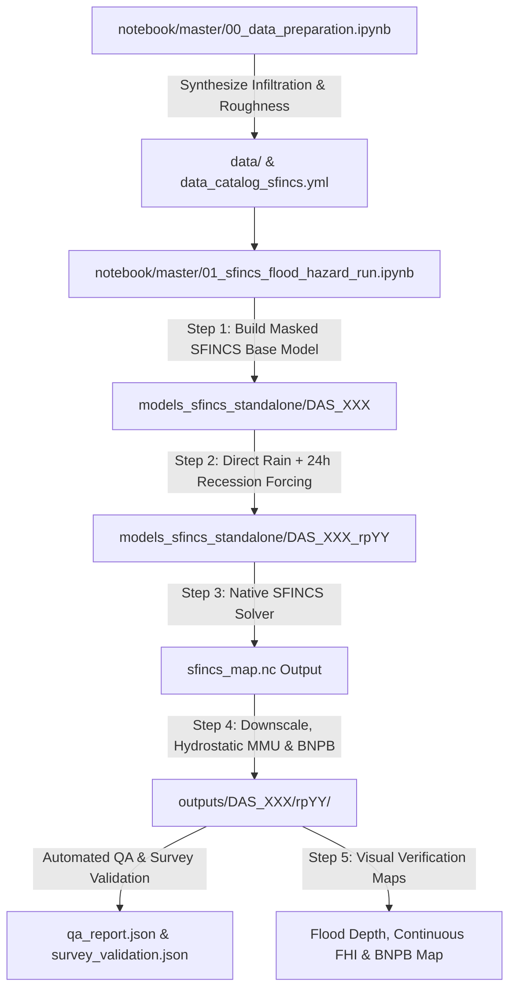

# TUTORIAL — Running Standalone HydroMT-SFINCS Flood Modeling

This tutorial guides you step-by-step through executing the complete **Standalone HydroMT-SFINCS 2D Flood Hazard Modeling Pipeline** across all **17 watershed clusters** (`DAS_101` to `DAS_114`, including Mentawai `DAS_108_A`–`D`) in Sumatera Barat.

---

## 🗺️ Workflow Overview



---

## Step 1 — Verify Prepared Datasets

Ensure the following core datasets are available under `data_raw/` and `data/`:

| Path | Data Type | Description |
| :--- | :--- | :--- |
| `data_raw/fabdem/FABDEM30m_Sumbar.tif` | Raster (30 m, WGS84) | Native bare-earth FABDEM (chipped & reprojected on-the-fly per DAS via `WarpedVRT`) |
| `data/cn_amc2_100m.tif` & `data/cn_amc3_100m.tif` | Raster (100 m) | USDA-NRCS SCS Curve Numbers (AMC-II & AMC-III) for SFINCS `CNB` infiltration (`generate_cn_raster.py`) |
| `data/soil_infiltration_100m.tif` | Raster (100 m) | Pre-calibrated AMC-III constant-loss fallback ($q_{\text{inf}} \in [0.00, 1.30]\text{ mm/hr}$) |
| `data/landcover_rbi.tif` | Raster (30 m) | BIG RBI integer land cover used for distributed Manning's $n$ mapping |
| `data/rivers.gpkg` & `data/rivers_ar.gpkg` | Vector (Line + Polygon) | BIG RBI river network & river-width polygons conditioned for silted channel burning |
| `data/lake.gpkg` | Vector (Polygon) | Permanent waterbody mask (excluded from land flood hazard) |
| `data/das_clusters/sumbar_das_cluster.gpkg` | Vector (Polygon) | 17 clustered watershed boundaries (`DAS_101`–`DAS_114`, Mentawai `DAS_108_A`–`D`) |
| `data/boundary_kabkot.gpkg` | Vector (Polygon) | Administrative boundaries for map overlays and reporting |
| `data/rainfall/` | NetCDF (`.nc`) | 24-hour design storm hyetographs (`RP2` to `RP100`) |

> **When to run `00_data_preparation.ipynb`:** For Sumatera Barat, all files above are already prepared—you can jump directly to `01_sfincs_flood_hazard_run.ipynb`. When starting a **new Indonesian *Kabupaten***, run [`notebook/master/00_data_preparation.ipynb`](../notebook/master/00_data_preparation.ipynb) **once** first (Auto-UTM will automatically detect the *Kabupaten*'s UTM zone across `EPSG:32646–32754` and generate all rasters + CN grids).

---

## Step 2 — Activate the Python Environment

Open PowerShell in the repository root and activate the unified `.venv` virtual environment:

```powershell
.\.venv\Scripts\activate
```

*(If you have not set up the environment yet, run `powershell -ExecutionPolicy Bypass -File .\env\setup_env.ps1` or `uv sync --extra dev` as detailed in the [Windows Installation Guide](WINDOWS_INSTALLATION_GUIDE.md)).*

Verify that the environment has `hydromt_sfincs`, `rioxarray`, and `geopandas` installed:

```powershell
.\.venv\Scripts\python.exe -c "import hydromt, hydromt_sfincs, geopandas, rioxarray; print(f'Ready: hydromt={hydromt.__version__}, sfincs={hydromt_sfincs.__version__}')"
```

---

## Step 3 — Run a Single-DAS Prototype

To run and inspect a single basin cluster (e.g., `DAS_106` or `DAS_101` for `rp100`):

1. Open [`notebook/master/01_sfincs_flood_hazard_run.ipynb`](../notebook/master/01_sfincs_flood_hazard_run.ipynb).
2. Select the **`.venv`** (or **`HydroMT-SFINCS`**) Python kernel in the top-right corner of VS Code.
3. Choose your build configuration in **Cell 1 (User Configuration Control Panel)**:
   * **Recommended Default — 80 m flux mesh / 10 m subgrid (~13× faster solver)**: `CONFIG_FILE = "configs/sfincs_standalone_build_80m_fast.yml"` *(use `MAX_EXT_DIST_M = 80.0`)*
   * **High-Resolution Urban Option — 40 m flux mesh / 10 m subgrid**: `CONFIG_FILE = "configs/sfincs_standalone_build.yml"` *(use `MAX_EXT_DIST_M = 40.0`)*
4. Run the cells in sequence:
   * **Cell 1 (User Configuration Control Panel)**: Set target cluster(s) and return period(s). Strict Scientific & Regulatory v2.0 defaults are pre-configured: `STORM_HOURS = 24`, `RECESSION_HOURS = None` (auto-scales `24/36/48 h` by catchment area), `INFILTRATION_MODE = 'cnb'` (single-counted AMC-II/AMC-III), `COASTAL_MHHW_M = 0.80` (Sumatera Barat default), `MIN_FLOOD_DEPTH_M = 0.15` (15 cm minimum flood hazard cutoff), and strict hydrostatic post-processing (`FREEBOARD_M = 0.0`, `MAX_EXT_DIST_M = 80.0`, `BRIDGE_RADIUS = 3`, `HOLE_MMU_HA = 1.0`, `ISLAND_MMU_HA = 0.09`, `MIN_HOLE_HA = 0.09`, `SMOOTH_SIGMA = 1.0`).
   * **Cell 2 (Environment & Data Verification)**: Loads `_env.py` PROJ/GDAL bindings and `sfincs_standalone_pipeline`.
   * **Cell 3 (Step 1: Base SFINCS Mesh)**: Extracts the on-the-fly 10 m DEM chip from native 30 m FABDEM, strictly masks active cells to `das_region` (`msk=0` outside basin), burns river channels enhanced with `rivers_ar.gpkg` (`n = 0.045`), applies RBI Manning roughness, injects inland `msk=3` outlets, and runs build-time QA.
   * **Cell 4 (Step 2: Direct Rainfall, CNB & Coastal MHHW Forcing)**: Applies the 24 h design hyetograph padded with dynamic zero-intensity recession hours, injects single-counted `CNB` Curve Number maps (`smaxfile`/`sefffile`/`ksfile`, `initial_sat_frac=0.0`), and applies `+0.80 m` Sumatera Barat coastal MHHW tidal backwater (`sfincs.bnd`/`sfincs.bzs`) on coastal domains (`alpha=0.65`, `huthresh=0.02`, `viscosity=0`).
   * **Cell 5 (Step 3: Run SFINCS Solver)**: Launches native `bin/sfincs.exe` with live progress tracking.
   * **Cell 6 (Step 4: Strict Hydrostatic Post-Processing [15 cm Floor], Subgrid QA & Validation)**:
     - Downscales water surface elevations ($z_s$) bilinearly onto 10 m subgrid topography and strictly removes all pixels below **`MIN_FLOOD_DEPTH_M = 0.15 m` (15 cm)** across Depth, FHI, and Classes rasters (Wing et al., 2018; Sampson et al., 2015; Bates et al., 2021).
     - Applies **pure bilinear edge-NaN recovery (`freeboard_m = 0.0`, `max_ext_dist_m = 80.0 m = 1.0 × dx`; zero synthetic water inflation)** and road/embankment bridging (`bridge_radius = 3` / `30 m`).
     - Enforces a **4-connected `30 m × 30 m` (`0.09 ha`) native FABDEM feature floor** (`island_mmu_ha=0.09`, `min_hole_ha=0.09`) and `1.0 ha` hydrostatically submerged void limit (`2 mm × 2 mm` @ 1:50,000; **SNI 6502.3:2010**, **Peraturan BIG No. 18/2021**) while protecting mapped RBI rivers from steep-slope pruning (`>= 8°`, Van Zuidam, 1985).
     - Classifies hazard levels (*Rendah* `0.15–0.76 m`, *Sedang* `0.76–1.50 m`, *Tinggi* `> 1.50 m`) per **Perka BNPB No. 02/2012** alongside a continuous Fuzzy Large FHI surrogate and companion QGIS `.qml` styles.
     - Automatically runs QA gates with **exact subgrid hypsometric volume balance** (`qa_report.json`) and outlier-screened QField validation (`survey_validation.json`).
   * **Cell 7 (Step 5: Visual Verification Maps)**: Renders the Flood Depth, continuous Fuzzy Large FHI, and BNPB 3-class maps.

---

## Step 4 — Master Batch Production (17 DAS $\times$ 6 Return Periods)

To process multiple or all 17 watershed clusters across all 6 return periods:

1. Open [`notebook/master/01_sfincs_flood_hazard_run.ipynb`](../notebook/master/01_sfincs_flood_hazard_run.ipynb).
2. Configure your target clusters and return periods in **Cell 1**:
   ```python
   SELECTED_CLUSTERS = ["DAS_101", "DAS_102", "DAS_106"]  # Or all 17 clusters (DAS_101..DAS_114, DAS_108_A..D)
   SELECTED_RPS = ["rp2", "rp5", "rp10", "rp25", "rp50", "rp100"]
   ```
3. Run the notebook sequentially or click **Run All**. After batch runs complete, reclaim temporary chip and cache storage anytime via:
   ```powershell
   .\.venv\Scripts\python.exe scripts/clean_storage.py --include-temp-chips --include-user-temp
   ```

---

## Step 5 — Output Artifacts Inspection

All model outputs are systematically structured in `outputs/{das_id}/{rp}/`:

```text
outputs/DAS_101/rp100/
├── DAS101_RP100_Flood_Depth.tif            # Hydrostatically refined maximum flood depth (m)
├── DAS101_RP100_Flood_Depth_raw.tif        # Raw unrefined downscaled simulation depth (m)
├── DAS101_RP100_FloodHazard_Index.tif      # Continuous Fuzzy Large Flood Hazard Index (0.0 to 1.0)
├── DAS101_RP100_FloodHazard_Index.qml      # QGIS continuous style ramp
├── DAS101_RP100_FloodHazard_Classes.tif    # Perka BNPB No. 02/2012 Classes (1: Rendah, 2: Sedang, 3: Tinggi)
├── DAS101_RP100_FloodHazard_Classes.qml    # QGIS discrete palette style
├── DAS101_RP100_Flood_Animation.gif        # Hourly flood wave propagation animation (Step 6)
├── qa_report.json                          # Automated QA audit (roughness, mask/boundaries, depth peaks, volume)
└── survey_validation.json                  # Outlier-screened validation against QField observations
```

Open these GeoTIFFs in **QGIS** — the companion `.qml` files automatically apply the official discrete Perka BNPB color palette (**Green `#34A853`**: Rendah `0.15–0.76 m`, **Amber `#FBBC05`**: Sedang `0.76–1.50 m`, **Red `#EA4335`**: Tinggi `> 1.50 m`; depths `< 0.15 m` are strictly excluded).
