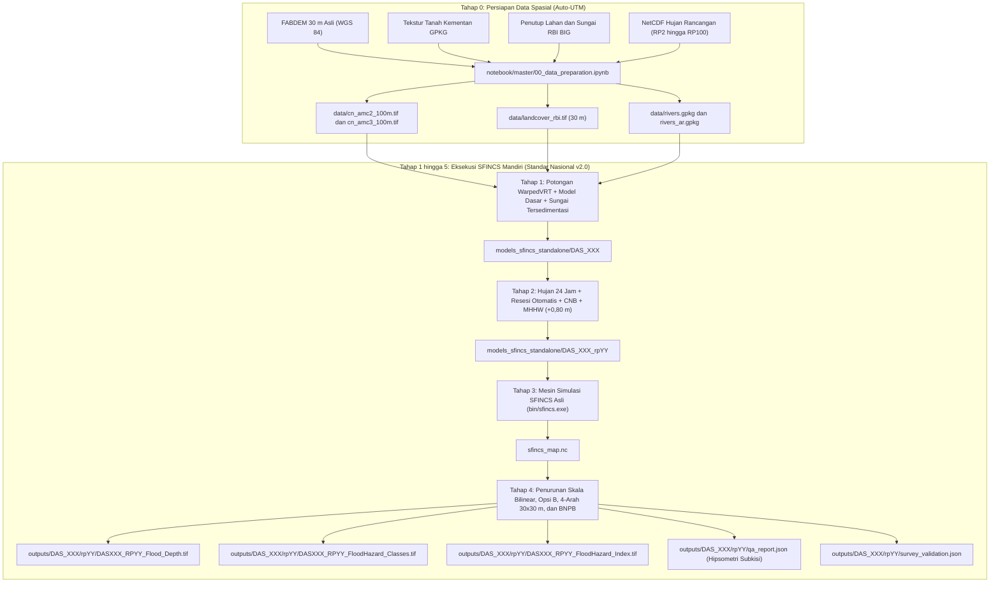

# Spesifikasi Teknis Alur Kerja Pemodelan Bahaya Banjir 2D HydroMT-SFINCS Mandiri

## Pemodelan Hidrodinamika 2D Hujan Langsung pada Kisi untuk 17 Klaster DAS Provinsi Sumatera Barat

> **Versi Bahasa:** Bahasa Indonesia | [English Version](../PIPELINE.md)

Dokumen ini disusun mengacu pada dokumentasi resmi Deltares serta literatur ilmiah yang telah melalui penelaahan sejawat (*peer-reviewed*):
- Plugin HydroMT-SFINCS: https://deltares.github.io/hydromt_sfincs/latest/
- Dokumentasi Model SFINCS: https://sfincs.readthedocs.io/en/latest/
- Inti HydroMT: https://deltares.github.io/hydromt/latest/
- Formulasi dan Validasi Global SFINCS: Leijnse et al. (2021); Eilander et al. (2023); Sadana et al. (2026)

---

## 1. Ringkasan Eksekutif dan Strategi Pemodelan

Repositori ini mengimplementasikan **Alur Kerja Pemodelan Bahaya Banjir Hidrodinamika 2D Mandiri (*Standalone*)** berbasis **Deltares SFINCS** (*Super-Fast INundation of CoastS*, versi 2.4.0 *Galibier Release*) melalui **HydroMT `0.10.1`** dan **`hydromt-sfincs 1.2.2`** pada seluruh **17 klaster Daerah Aliran Sungai (DAS)** (`DAS_101` sampai dengan `DAS_114`, termasuk Kepulauan Mentawai `DAS_108_A` hingga `DAS_108_D`) di Provinsi Sumatera Barat, Indonesia.

### Prinsip Inti Pemodelan (Standar Nasional Kabupaten/Kota v2.0)

1. **Deteksi Zona UTM Otomatis dan Portabilitas Nasional:**
   Sistem mendeteksi zona proyeksi WGS 84 UTM secara otomatis untuk seluruh wilayah Indonesia (`EPSG:32646` hingga `EPSG:32654` untuk belahan bumi utara dan `EPSG:32746` hingga `EPSG:32754` untuk belahan bumi selatan melalui `scripts/geo_utils.py`), serta menstandardisasi parameterisasi penutup lahan RBI BIG menggunakan tabel kanonik nasional 15 kelas (`lookup_tables/national_rbi_lookup.csv`).
2. **Pemodelan Hujan Langsung pada Kisi dengan Resesi Dinamis (Aliran Pluvial dan Fluvial Terpadu):**
   SFINCS menerapkan hidrograf hujan rancangan 24 jam secara langsung pada seluruh sel komputasi aktif, dilengkapi tambahan jam resesi tanpa hujan yang skalanya disesuaikan secara dinamis menurut luas DAS (`24 jam` untuk luas `< 500 km²`, `36 jam` untuk `500 sampai 1.500 km²`, dan `48 jam` untuk `> 1.500 km²`), opsi Faktor Reduksi Luas (*Areal Reduction Factor* / ARF USWB/WMO dengan nilai bawaan `apply_arf=False`), serta penyetelan numerik stabil (`alpha=0.65`, `huthresh=0.02`, `viscosity=0`).
3. **Pembatasan Domain DAS Aktif, Pasang Surut MHHW Pesisir, dan Batas Keluaran Daratan:**
   Sel komputasi aktif dibatasi secara ketat pada poligon DAS hidrologis (`mask: das_region`, `reset_mask: true`) sehingga wilayah laut terbuka dan DAS tetangga tetap tidak aktif (`msk=0`), mengurangi jumlah sel komputasi aktif sebesar 40% hingga 70%. Sel batas muka air pesisir (`msk=2`, $z \le 0$) diberi tinggi muka air pasang tertinggi rata-rata (**MHHW `+0,80 m`**) melalui berkas `sfincs.bnd` dan `sfincs.bzs`, sedangkan DAS daratan diberi batas aliran keluar (`msk=3`) pada titik keluaran sungai berelevasi terendah.
4. **Topografi Subkisi, Pemotongan DEM Langsung, dan Pembakaran Saluran Sungai:**
   Secara baku menggunakan **kisi fluks 80 m dan subkisi 10 m (standar V3)** (`configs/sfincs_standalone_build_80m_fast.yml`, `nr_subgrid_pixels: 8`, sekitar 13 kali lebih cepat dengan indeks `F1 = 0,908` terhadap 40 m), serta menyediakan opsi resolusi tinggi **40 m / 10 m** (`configs/sfincs_standalone_build.yml`, `nr_subgrid_pixels: 4`). Potongan DEM per DAS diekstraksi dan diproyeksikan ulang secara bilinear langsung (*on-the-fly*) melalui GDAL `WarpedVRT` dari **FABDEM 30 m asli** (`data_raw/fabdem/FABDEM30m_Sumbar.tif`). Garis tengah sungai yang diperkaya poligon lebar sungai RBI BIG (`data/rivers_ar.gpkg`) dibakar ke dalam tabel subkisi dengan geometri sungai tersedimentasi khas Indonesia ($w = 8/15/22\text{ m}$, $d = 0,35/0,55/0,80\text{ m}$, Manning $n = 0,045$).
5. **Infiltrasi Metode Bilangan Kurva USDA-NRCS Modern (`CNB`):**
   Menggunakan skema *Curve Number with Recovery* SFINCS `v2.4.0+` (`smaxfile`, `sefffile`, `ksfile` dalam satuan meter) yang disintesis dari **Kelompok Tanah Hidrologi (HSG) Kementerian Pertanian x Penutup Lahan RBI BIG** (`scripts/generate_cn_raster.py`, kondisi `AMC-II` terisi awal 25% untuk `RP2` hingga `RP10` dan `AMC-III` terisi awal 50% untuk `RP25` hingga `RP100`). Skema lama `scsfile` secara tegas dihindari karena cacat *zero-runoff* pada SFINCS `v2.4.0`, sedangkan raster laju infiltrasi konstan (`data/soil_infiltration_100m.tif`) dipertahankan sebagai cadangan eksplisit.
6. **Pengolahan Pascasimulasi Opsi B, Audit Volume Subkisi, dan Standar BNPB:**
   Elevasi muka air ($z_s$) diturunkan skalanya secara bilinear ke topografi subkisi 10 m, kemudian tepian dataran banjir yang terpotong interpolasi bilinear dipulihkan dengan **margin ketidakpastian vertikal FABDEM `+0,35 m` (standar 80 m V3)** (di bawah galat rata-rata absolut FABDEM ~`0,50 m`, Hawker et al., 2022; dibatasi ketat pada dataran banjir landai terhubung `< 5 derajat` dalam jarak `<= 120 m` atau `1,5 x dx`, meluruh mulus ke `0 m` sehingga perbukitan curam tetap kering; atau `+0,25 m / <= 80 m / r=5` untuk mode 40 m). Koridor sungai RBI dilindungi saat penyaringan lereng curam, diikuti pembersihan bercak dan lubang terhubung 4 arah berukuran **`30 m x 30 m` (`0,09 ha`)** (`island_mmu_ha=0.09`, `min_hole_ha=0.09`, `hole_mmu_ha=2.0`, `bridge_radius=6`, $\sigma = 1,2\text{ piksel}$; mengacu **SNI 6502.3:2010** dan **Peraturan BIG Nomor 18 Tahun 2021**), verifikasi neraca massa melalui **kurva penyimpanan hipsometri subkisi** (`sfincs_subgrid.nc`), klasifikasi bahaya mengacu **Peraturan Kepala BNPB Nomor 02 Tahun 2012**, perhitungan Indeks Bahaya Banjir (*Fuzzy Large*), serta validasi data survei lapangan QField.

---

## 2. Formulasi Teoretis dan Persamaan Pengatur

SFINCS menyelesaikan persamaan air dangkal dua dimensi terintegrasi kedalaman yang disederhanakan (pendekatan inersia lokal dan gelombang difusif) yang dipadukan dengan integrasi elevasi-volume serta kekasaran subkisi (Leijnse et al., 2021; Volp et al., 2013).

### 2.1 Persamaan Kontinuitas (Kekekalan Massa)
$$\frac{\partial \eta}{\partial t} + \frac{\partial (h u)}{\partial x} + \frac{\partial (h v)}{\partial y} = P - q_{\text{inf}}$$

Keterangan:
* $\eta(x, y, t)$: Elevasi muka air di atas datum (m).
* $h(x, y, t) = \eta - z_b$: Kedalaman air lokal (m), dengan $z_b$ adalah elevasi dasar tanah.
* $u, v$: Kecepatan aliran rata-rata kedalaman pada arah $x$ dan $y$ (m/detik).
* $P(x, y, t)$: Intensitas hujan langsung dari hidrograf rancangan 24 jam (m/detik).
* $q_{\text{inf}}(x, y)$: Laju infiltrasi tanah terdistribusi secara spasial (m/detik).

### 2.2 Keseimbangan Momentum (Gesekan Permukaan dan Gravitasi)
Pada formulasi air dangkal subkisi yang disederhanakan (dengan inersia lokal dikendalikan oleh parameter `alpha` dan gesekan dasar diatur oleh koefisien Manning $n$ terdistribusi):
$$u = \frac{R^{2/3}}{n \sqrt{|\nabla \eta|}} \left(-\frac{\partial \eta}{\partial x}\right), \qquad v = \frac{R^{2/3}}{n \sqrt{|\nabla \eta|}} \left(-\frac{\partial \eta}{\partial y}\right)$$

Keterangan: $R$ adalah jari-jari hidraulis subkisi dan $n$ adalah koefisien kekasaran permukaan Manning yang dipetakan dari Penutup Lahan RBI BIG (`lookup_tables/manning_lookup.csv`).

---

## 3. Parameterisasi Fisik Infiltrasi Tanah

### 3.1 Standar Utama v2.0: Bilangan Kurva USDA-NRCS dengan Pemulihan (`CNB`)
Secara baku (`infiltration_mode="cnb"`), alur kerja v2.0 menggunakan skema SFINCS `v2.4.0+` **Curve Number with Recovery (`smaxfile`, `sefffile`, `ksfile`)** dalam satuan meter yang dibangkitkan oleh `scripts/generate_cn_raster.py` dari persilangan **Tekstur Tanah Kementerian Pertanian (HSG A hingga D) x Penutup Lahan RBI BIG Kanonik (`lookup_tables/national_rbi_lookup.csv`)**:
* **Retensi Kelembapan Tanah Maksimum:** $S_{\max} = \left(\frac{1000}{\text{CN}} - 10\right) \times 0,0254\text{ m}$
* **Kejenuhan Tanah Awal Berdasarkan Kala Ulang:**
  - Hujan kala ulang sering (`RP2` hingga `RP10`): `data/cn_amc2_100m.tif` (`AMC-II`, terisi awal 25% sehingga `seff = 0.75 * S_max`)
  - Hujan monsun ekstrem (`RP25` hingga `RP100`): `data/cn_amc3_100m.tif` (`AMC-III`, terisi awal 50% sehingga `seff = 0.50 * S_max`)
* **Pengaman Kritis Mesin Simulasi:** Berkas lama `scsfile` (`cna`) secara tegas dilarang dan dihapus dari `sfincs.inp` karena `SFINCS v2.4.0 Galibier` memiliki cacat *zero-runoff* saat memadukan `scsfile` dengan `netamprfile`.

### 3.2 Opsi Cadangan: Matriks Kehilangan Konstan Pra-Jenuh AMC-III (`qinf`)
Apabila `infiltration_mode="qinf"` dipilih (atau raster CN belum tersedia), sistem beralih ke matriks infiltrasi konstan AMC-III terkalibrasi (`lookup_tables/soil_infiltration_lookup.csv`, `amc_scale=1.0` tanpa penskalaan ganda) yang merepresentasikan tanah jenuh musim hujan (USDA-NRCS, 2004; Arsyad, 2010; Triatmodjo, 2008):

| Tekstur Tanah Kementan | Sawah | Permukiman | Tegalan / Ladang | Perkebunan | Hutan | Semak Belukar | Baku |
| :--- | :---: | :---: | :---: | :---: | :---: | :---: | :---: |
| **Halus (Liat)** | `0.025` | `0.005` | `0.090` | `0.110` | `0.225` | `0.130` | `0.090` |
| **Agak Halus (Lempung Berliat)** | `0.025` | `0.005` | `0.170` | `0.150` | `0.340` | `0.190` | `0.150` |
| **Sedang (Lempung)** | `0.025` | `0.005` | `0.280` | `0.225` | `0.550` | `0.300` | `0.260` |
| **Agak Kasar (Lempung Berpasir)** | `0.025` | `0.005` | `0.450` | `0.375` | `0.825` | `0.525` | `0.450` |
| **Kasar (Pasir)** | `0.025` | `0.005` | `0.750` | `0.550` | `1.300` | `0.825` | `0.750` |
| **Gambut** | `0.025` | `0.005` | `0.075` | `0.090` | `0.110` | `0.090` | `0.075 hingga 0.110` |
| **Badan Air** | `0.000` | `0.000` | `0.000` | `0.000` | `0.000` | `0.000` | `0.000` |

*(Satuan: $\text{mm/jam}$. Catatan: Untuk pengembangan masa depan v3.0 menuju **HydroMT-SFINCS v2.0+ / SFINCS v2.5.0 Hautacam**, peta `CNB` ini dapat dimigrasikan secara langsung ke format NetCDF `inffile` dengan `inftype = cnb` beserta penyempurnaan adaptif Quadtree).*

---

## 4. Arsitektur Alur Kerja Menyeluruh



---

## 5. Standar Klasifikasi Bahaya Banjir BNPB dan Pengolahan Pascasimulasi

Klasifikasi bahaya banjir mengacu pada **Peraturan Kepala BNPB Nomor 02 Tahun 2012 tentang Pedoman Umum Pengkajian Risiko Bencana**:

### 5.1 Matriks Ambang Kedalaman Genangan
* **Rendah (Kelas 1):** $0,05\text{ m} \le h < 0,76\text{ m}$ (Hijau `#34A853`)
* **Sedang (Kelas 2):** $0,76\text{ m} \le h \le 1,50\text{ m}$ (Kuning `#FBBC05`)
* **Tinggi (Kelas 3):** $h > 1,50\text{ m}$ (Merah `#EA4335`)

### 5.2 Indeks Bahaya Banjir Kontinu (*Fuzzy Large Membership*)
$$\text{FHI}(h) = \frac{1}{1 + \left(\frac{h}{x_0}\right)^{-s}}, \quad x_0 = 1,125\text{ m},\; s = 1,75$$

### 5.3 Margin Hidrostatis Alami Opsi B, Penghalusan Tepi, dan Ambang 4 Arah `30 m x 30 m`
Untuk menghilangkan artefak diskritisasi kisi dan penyempitan tepi akibat interpolasi bilinear sekaligus menjaga kawasan perbukitan tetap kering, modul pascasimulasi v2.0 menjalankan 6 tahapan penyaringan hidrostatis:
1. **Penyaringan Derau Lereng Curam dengan Perlindungan Sungai RBI:** Menghapus artefak aliran tipis terisolasi pada lereng curam ($\ge 8^\circ$) sambil **selalu melindungi koridor sungai RBI BIG** (penyangga 30 m) agar alur banjir bandang pegunungan tetap terjaga.
2. **Margin Dataran Banjir Alami Terhubung Hidrostatis Opsi B (80 m V3):** Mengekstrapolasikan permukaan muka air terhaluskan ($z_s$) ke arah luar hingga `120 m` (`max_ext_dist_m=120.0`, setara `1,5 x dx` pada mode baku 80 m; atau `80,0 m` pada mode 40 m) untuk memulihkan piksel tepi yang berada di bawah $z_s$, ditambah margin ketidakpastian vertikal FABDEM yang meluruh secara bertahap sebesar **`+0,35 m`** (`freeboard_m=0.35`, di bawah galat MAE FABDEM ~`0,50 m` menurut Hawker et al., 2022; atau `0,25 m` pada mode 40 m) yang **dibatasi ketat** pada dataran banjir landai terhubung (`kemiringan < 5 derajat`). Perbukitan tinggi, lereng curam, dan cekungan terputus tetap kering.
3. **Penjembatanan Hidromorfologi dan Pengisian Rongga Tertutup:** Kernel cakram (`bridge_radius=6`, radius 60 m; atau `5` pada mode 40 m) menjembatani tanggul jalan sempit atau gorong-gorong dan mengisi rongga datar tertutup (`hole_mmu_ha=2.0`, diskalakan otomatis ke jumlah piksel; mengacu **SNI 6502.3:2010** dan **Peraturan BIG Nomor 18 Tahun 2021**) hanya pada area yang tergenang secara hidrostatis.
4. **Penghalusan Batas (*Boundary Anti-Aliasing*):** Transformasi jarak bertanda Euclidean ($\sigma = 1,2\text{ piksel}$) menghilangkan tepian genangan bergerigi.
5. **Pembersihan Bercak dan Lubang Terhubung 4 Arah `30 m x 30 m` (`0,09 ha`):** Menerapkan batas minimum setara **1 piksel sensor FABDEM (`0,09 ha`)** (`island_mmu_ha=0.09`, `min_hole_ha=0.09`) menggunakan konektivitas 4 arah (*rook*) untuk menghilangkan seluruh lubang mikro dan bercak diagonal pada tampilan QGIS.
6. **Kendali Mutu Hipsometri Subkisi dan Validasi Survei:** Memverifikasi neraca massa langsung dari `sfincs_subgrid.nc` (`z_level`, `z_volmax`) melalui `scripts/qa_checks.py` dan melakukan validasi terhadap titik observasi lapangan QField tersaring pencilan (`max_valid_depth_m=8.0` pada `scripts/validate_against_survey.py`).

---

## 6. Lingkungan Eksekusi Python (`.venv` berbasis `uv`)

Alur kerja berjalan pada satu lingkungan virtual Python 3.12 terpadu yang dikelola oleh **`uv`**:

```powershell
uv sync --extra dev
.\.venv\Scripts\python.exe -m ipykernel install --user --name hydromt-sfincs --display-name "HydroMT-SFINCS"
.\.venv\Scripts\python.exe -m pytest
```

Seluruh pustaka C (`gdal`, `geos`, `proj`, `netcdf4`, `openmp`) telah dibundel secara lokal tanpa memerlukan Docker pada Windows.

---

## 7. Daftar Pustaka Ilmiah dan Peraturan Perundang-undangan

1. **Leijnse, T., van Ormondt, M., Nederhoff, K., & van Dongeren, A. (2021).** *Modeling compound flooding in coastal systems using a computationally efficient reduced-physics solver: Including fluvial, pluvial, tidal, wind- and wave-driven processes.* **Coastal Engineering**, 163, 103796. [https://doi.org/10.1016/j.coastaleng.2020.103796](https://doi.org/10.1016/j.coastaleng.2020.103796)
2. **Eilander, D., Boisgontier, H., Bouaziz, L. J. E., Buitink, J., Couasnon, A., Dalmijn, B., Hegnauer, M., de Jong, T., Loos, S., Marth, I., & van Verseveld, W. (2023).** *HydroMT: Automated and reproducible model building and analysis.* **Journal of Open Source Software**, 8(83), 4897. [https://doi.org/10.21105/joss.04897](https://doi.org/10.21105/joss.04897)
3. **Eilander, D., Couasnon, A., Leijnse, T., Ikeuchi, H., Yamazaki, D., Muis, S., Dullaart, J., Haag, A., Winsemius, H. C., & Ward, P. J. (2023).** *A globally applicable framework for compound flood hazard modeling.* **Natural Hazards and Earth System Sciences**, 23(2), 823 hingga 846. [https://doi.org/10.5194/nhess-23-823-2023](https://doi.org/10.5194/nhess-23-823-2023)
4. **Sadana, T., Aerts, J. C. J. H., Eilander, D., Merz, B., de Moel, H., Busker, T., Bril, V. C., & de Bruijn, J. (2026).** *Validation of the open-source hydrodynamic model SFINCS on historical river floods at the global scale.* **Hydrology and Earth System Sciences**, 30(17), 5491 hingga 5519. [https://doi.org/10.5194/hess-30-5491-2026](https://doi.org/10.5194/hess-30-5491-2026)
5. **Volp, N. D., van Prooijen, B. C., & Stelling, G. S. (2013).** *A finite volume approach for shallow water flow accounting for high-resolution bathymetry and roughness data.* **Water Resources Research**, 49(7), 4126 hingga 4135. [https://doi.org/10.1002/wrcr.20315](https://doi.org/10.1002/wrcr.20315)
6. **Hawker, L., Uhe, P., Paulo, L., Sosa, J., Savage, J., Sampson, C., & Neal, J. (2022).** *A 30m global map of elevation with forests and buildings removed.* **Environmental Research Letters**, 17(2), 024016. [https://doi.org/10.1088/1748-9326/ac4d4f](https://doi.org/10.1088/1748-9326/ac4d4f)
7. **USDA Natural Resources Conservation Service (2004).** *National Engineering Handbook (NEH), Part 630: Hydrology, Chapter 10.* USDA-NRCS, Washington, D.C.
8. **Arsyad, S. (2010).** *Konservasi Tanah dan Air* (Edisi Kedua). IPB Press, Bogor; dan **Triatmodjo, B. (2008).** *Hidrologi Terapan.* Beta Offset, Yogyakarta.
9. **Chow, V. T. (1959).** *Open-Channel Hydraulics.* McGraw-Hill, New York; dan **Arcement, G. J., & Schneider, V. R. (1989).** *Guide for Selecting Manning's Roughness Coefficients for Natural Channels and Flood Plains.* USGS Water-Supply Paper 2339. [https://doi.org/10.3133/wsp2339](https://doi.org/10.3133/wsp2339)
10. **Soille, P. (2003).** *Morphological Image Analysis: Principles and Applications* (2nd ed.). Springer. [https://doi.org/10.1007/978-3-662-05088-0](https://doi.org/10.1007/978-3-662-05088-0); dan **Borgefors, G. (1986).** *Distance transformations in digital images.* CVGIP, 34(3), 344 hingga 371. [https://doi.org/10.1016/S0734-189X(86)80047-0](https://doi.org/10.1016/S0734-189X(86)80047-0)
11. **Klir, G. J., & Yuan, B. (1995).** *Fuzzy Sets and Fuzzy Logic: Theory and Applications.* Prentice Hall, Upper Saddle River, NJ.
12. **Peraturan Kepala BNPB Nomor 02 Tahun 2012** (*Pedoman Umum Pengkajian Risiko Bencana*), **SNI 2830:2008**, **SNI 6502.3:2010** (*Peta Rupabumi Skala 1:50.000*), dan **Peraturan BIG Nomor 18 Tahun 2021** (*Tata Cara Penyelenggaraan Informasi Geospasial*).
