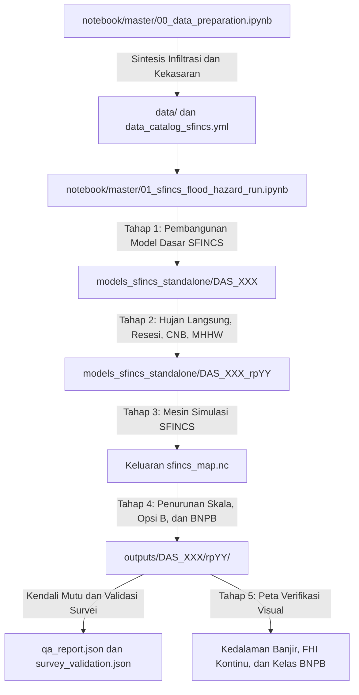

# Petunjuk Teknis Pelaksanaan Pemodelan Bahaya Banjir HydroMT-SFINCS Mandiri

> **Versi Bahasa:** Bahasa Indonesia | [English Version](../TUTORIAL.md)

Petunjuk teknis ini memandu pengguna secara bertahap dalam menjalankan seluruh rangkaian **Alur Kerja Pemodelan Bahaya Banjir Hidrodinamika 2D Mandiri HydroMT-SFINCS** pada seluruh **17 klaster Daerah Aliran Sungai (DAS)** (`DAS_101` sampai dengan `DAS_114`, termasuk Kepulauan Mentawai `DAS_108_A` hingga `DAS_108_D`) di Provinsi Sumatera Barat.

---

## Ringkasan Alur Kerja



---

## Tahap 1: Pemeriksaan Ketersediaan Data Masukan

Pastikan seluruh berkas data utama berikut telah tersedia di dalam direktori `data_raw/` dan `data/`:

| Jalur Berkas | Jenis Data | Keterangan |
| :--- | :--- | :--- |
| `data_raw/fabdem/FABDEM30m_Sumbar.tif` | Raster (30 m, WGS 84) | Data elevasi permukaan tanah asli FABDEM (dipotong dan diproyeksikan langsung per DAS melalui `WarpedVRT`) |
| `data/cn_amc2_100m.tif` dan `data/cn_amc3_100m.tif` | Raster (100 m) | Bilangan Kurva (*Curve Number*) USDA-NRCS kondisi AMC-II dan AMC-III untuk infiltrasi `CNB` SFINCS (`generate_cn_raster.py`) |
| `data/soil_infiltration_100m.tif` | Raster (100 m) | Laju infiltrasi konstan cadangan kondisi jenuh AMC-III ($q_{\text{inf}} \in [0,00; 1,30]\text{ mm/jam}$) |
| `data/landcover_rbi.tif` | Raster (30 m) | Penutup Lahan RBI BIG berkode bilangan bulat untuk pemetaan koefisien kekasaran Manning ($n$) |
| `data/rivers.gpkg` dan `data/rivers_ar.gpkg` | Vektor (Garis dan Poligon) | Jaringan garis tengah sungai dan poligon lebar tubuh sungai RBI BIG untuk pembakaran saluran |
| `data/lake.gpkg` | Vektor (Poligon) | Masker badan air permanen (dikeluarkan dari kawasan bahaya banjir daratan) |
| `data/das_clusters/sumbar_das_cluster.gpkg` | Vektor (Poligon) | Batas 17 klaster DAS (`DAS_101` sampai dengan `DAS_114`, serta Mentawai `DAS_108_A` hingga `DAS_108_D`) |
| `data/boundary_kabkot.gpkg` | Vektor (Poligon) | Batas wilayah administrasi kabupaten/kota untuk tumpang susun peta dan pelaporan |
| `data/rainfall/` | NetCDF (`.nc`) | Hidrograf hujan rancangan 24 jam per jam (`RP2` sampai dengan `RP100`) |

> [!NOTE]
> **Kapan perlu menjalankan `00_data_preparation.ipynb`:** Untuk wilayah Provinsi Sumatera Barat, seluruh berkas siap pakai di atas telah tersedia sehingga pengguna dapat langsung menjalankan `01_sfincs_flood_hazard_run.ipynb`. Apabila menerapkan alur kerja ini pada **wilayah kabupaten/kota lain di Indonesia**, jalankan [`notebook/master/00_data_preparation.ipynb`](../../notebook/master/00_data_preparation.ipynb) **satu kali** di awal (fitur Auto-UTM akan mendeteksi zona UTM secara otomatis pada rentang `EPSG:32646` hingga `EPSG:32754` dan membangkitkan seluruh raster masukan serta raster CN).

---

## Tahap 2: Aktivasi Lingkungan Python

Buka PowerShell pada direktori utama repositori dan aktifkan lingkungan virtual terpadu `.venv`:

```powershell
.\.venv\Scripts\activate
```

*(Apabila lingkungan belum terpasang, jalankan `powershell -ExecutionPolicy Bypass -File .\env\setup_env.ps1` atau `uv sync --extra dev` sesuai [Panduan Instalasi Windows](PANDUAN_INSTALASI_WINDOWS.md)).*

Pastikan pustaka `hydromt_sfincs`, `rioxarray`, dan `geopandas` telah terpasang dengan baik:

```powershell
.\.venv\Scripts\python.exe -c "import hydromt, hydromt_sfincs, geopandas, rioxarray; print(f'Siap: hydromt={hydromt.__version__}, sfincs={hydromt_sfincs.__version__}')"
```

---

## Tahap 3: Pelaksanaan Uji Coba Satu Klaster DAS

Untuk menjalankan dan memeriksa hasil pemodelan pada satu klaster DAS (misalnya `DAS_106` atau `DAS_101` pada kala ulang `rp100`):

1. Buka berkas [`notebook/master/01_sfincs_flood_hazard_run.ipynb`](../../notebook/master/01_sfincs_flood_hazard_run.ipynb).
2. Pilih kernel Python **`.venv`** (atau **`HydroMT-SFINCS`**) pada sudut kanan atas VS Code.
3. Pilih konfigurasi kisi komputasi pada **Sel 1 (Panel Kendali Konfigurasi Pengguna)**:
   * **Konfigurasi Baku yang Disarankan (Kisi Fluks 80 m / Subkisi 10 m, sekitar 13 kali lebih cepat):** `CONFIG_FILE = "configs/sfincs_standalone_build_80m_fast.yml"` *(gunakan `MAX_EXT_DIST_M = 80.0`)*
   * **Opsi Resolusi Tinggi Perkotaan (Kisi Fluks 40 m / Subkisi 10 m):** `CONFIG_FILE = "configs/sfincs_standalone_build.yml"` *(gunakan `MAX_EXT_DIST_M = 40.0`)*
4. Jalankan sel-sel berikut secara berurutan:
   * **Sel 1 (Panel Kendali Konfigurasi Pengguna):** Tetapkan klaster DAS dan kala ulang sasaran. Parameter baku Standar Ilmiah dan Regulasi v2.0 telah diatur sebelumnya: `STORM_HOURS = 24`, `RECESSION_HOURS = None` (otomatis `24`, `36`, atau `48` jam sesuai luas DAS), `INFILTRATION_MODE = 'cnb'` (AMC-II/AMC-III tanpa penghitungan ganda), `COASTAL_MHHW_M = 0.80` (baku Sumatera Barat), `MIN_FLOOD_DEPTH_M = 0.15` (ambang minimum bahaya banjir 15 cm), serta parameter pascasimulasi hidrostatis ketat (`FREEBOARD_M = 0.0`, `MAX_EXT_DIST_M = 80.0`, `BRIDGE_RADIUS = 3`, `HOLE_MMU_HA = 1.0`, `ISLAND_MMU_HA = 0.09`, `MIN_HOLE_HA = 0.09`, `SMOOTH_SIGMA = 1.0`).
   * **Sel 2 (Verifikasi Lingkungan dan Data):** Memuat konfigurasi jalur PROJ/GDAL dari `_env.py` dan modul `sfincs_standalone_pipeline`.
   * **Sel 3 (Tahap 1: Pembangunan Kisi Dasar SFINCS):** Memotong DEM 10 m secara langsung dari FABDEM 30 m, membatasi sel aktif secara ketat pada `das_region` (`msk=0` di luar DAS), membakar alur sungai yang diperkaya poligon lebar `rivers_ar.gpkg` (`n = 0,045`), menerapkan kekasaran Manning RBI, menambahkan batas keluaran daratan (`msk=3`), serta menjalankan gerbang kendali mutu pembangunan model.
   * **Sel 4 (Tahap 2: Pemaksaan Hujan Langsung, Infiltrasi CNB, dan MHHW Pesisir):** Menerapkan hidrograf hujan rancangan 24 jam beserta periode resesi nol hujan dinamis, menyuntikkan peta `CNB` tunggal (`smaxfile`, `sefffile`, `ksfile` dengan `initial_sat_frac=0.0`), serta menerapkan tinggi muka air pasang surut MHHW Sumatera Barat `+0,80 m` (`sfincs.bnd`, `sfincs.bzs`) pada DAS pesisir (`alpha=0.65`, `huthresh=0.02`, `viscosity=0`).
   * **Sel 5 (Tahap 3: Eksekusi Mesin Simulasi SFINCS):** Menjalankan berkas biner `bin/sfincs.exe` secara lokal dengan pemantauan progres langsung.
   * **Sel 6 (Tahap 4: Pengolahan Pascasimulasi Hidrostatis Ketat [Minimum 15 cm], QA Subkisi, dan Validasi):**
     - Menurunkan skala elevasi muka air ($z_s$) secara bilinear ke topografi subkisi 10 m serta menghapus seluruh piksel dengan kedalaman di bawah **`MIN_FLOOD_DEPTH_M = 0,15 m` (`15 cm`)** pada raster Kedalaman, Indeks Bahaya, dan Kelas Bahaya (Wing et al., 2018; Sampson et al., 2015; Bates et al., 2021).
     - Menerapkan **pemulihan tepi `bilinear edge-NaN` murni tanpa penambahan tinggi air sintetis (`freeboard_m = 0,0 m`, `max_ext_dist_m = 80,0 m`)** serta penjembatanan jalan/tanggul (`bridge_radius = 3` / `30 m`).
     - Menerapkan ambang pembersihan bercak dan lubang terhubung 4 arah berukuran **`30 m x 30 m` (`0,09 ha`, setara 1 piksel asli FABDEM)** serta batas rongga tergenang hidrostatis `1,0 ha` (`2 mm x 2 mm` skala 1:50.000; **SNI 6502.3:2010** dan **Peraturan BIG Nomor 18 Tahun 2021**) sambil melindungi koridor sungai RBI dari penyaringan lereng curam (`>= 8 derajat`, Van Zuidam, 1985).
     - Mengklasifikasikan tingkat bahaya banjir (*Rendah* `0,15 hingga 0,76 m`, *Sedang* `0,76 hingga 1,50 m`, *Tinggi* `> 1,50 m`) sesuai **Peraturan Kepala BNPB Nomor 02 Tahun 2012** beserta surogat Indeks Bahaya Banjir (*Fuzzy Large*) dan berkas simbolisasi QGIS `.qml`.
     - Menjalankan secara otomatis pemeriksaan kendali mutu dengan **neraca volume berbasis hipsometri subkisi** (`qa_report.json`) serta validasi data survei lapangan QField (`survey_validation.json`).
   * **Sel 7 (Tahap 5: Visualisasi Peta Verifikasi):** Menampilkan peta kedalaman genangan, Indeks Bahaya Banjir (*Fuzzy Large*), dan peta 3 kelas bahaya BNPB.

---

## Tahap 4: Produksi Massal (17 Klaster DAS x 6 Kala Ulang)

Untuk memproses beberapa klaster atau seluruh 17 klaster DAS pada seluruh 6 skenario kala ulang:

1. Buka berkas [`notebook/master/01_sfincs_flood_hazard_run.ipynb`](../../notebook/master/01_sfincs_flood_hazard_run.ipynb).
2. Atur daftar klaster DAS dan kala ulang pada **Sel 1**:
   ```python
   SELECTED_CLUSTERS = ["DAS_101", "DAS_102", "DAS_106"]  # Atau seluruh 17 klaster (DAS_101 hingga DAS_114, DAS_108_A hingga D)
   SELECTED_RPS = ["rp2", "rp5", "rp10", "rp25", "rp50", "rp100"]
   ```
3. Jalankan notebook secara berurutan atau klik **Run All**. Setelah produksi massal selesai, ruang penyimpanan sementara dapat dibersihkan kapan saja menggunakan perintah berikut:
   ```powershell
   .\.venv\Scripts\python.exe scripts/clean_storage.py --include-temp-chips --include-user-temp
   ```

---

## Tahap 5: Pemeriksaan Produk Keluaran

Seluruh berkas keluaran model disusun secara sistematis di dalam folder `outputs/{das_id}/{rp}/`:

```text
outputs/DAS_101/rp100/
├── DAS101_RP100_Flood_Depth.tif            # Kedalaman genangan maksimum terhaluskan secara hidrostatis (m)
├── DAS101_RP100_Flood_Depth_raw.tif        # Kedalaman hasil penurunan skala mentah (m)
├── DAS101_RP100_FloodHazard_Index.tif      # Indeks Bahaya Banjir kontinu Fuzzy Large (0,0 hingga 1,0)
├── DAS101_RP100_FloodHazard_Index.qml      # Gaya gradasi warna kontinu untuk QGIS
├── DAS101_RP100_FloodHazard_Classes.tif    # Kelas Bahaya Perka BNPB No. 02/2012 (1: Rendah, 2: Sedang, 3: Tinggi)
├── DAS101_RP100_FloodHazard_Classes.qml    # Gaya palet warna diskrit resmi BNPB untuk QGIS
├── DAS101_RP100_Flood_Animation.gif        # Animasi perambatan gelombang banjir per jam (Tahap 6)
├── qa_report.json                          # Laporan audit kendali mutu otomatis (kekasaran, batas, puncak, volume)
└── survey_validation.json                  # Laporan validasi lapangan QField dengan penyaringan pencilan
```

Buka berkas GeoTIFF tersebut pada aplikasi **QGIS**. Berkas `.qml` pendamping akan otomatis menerapkan palet warna resmi Peraturan Kepala BNPB Nomor 02 Tahun 2012 (**Hijau `#34A853`**: Rendah `0,15 hingga 0,76 m`, **Kuning `#FBBC05`**: Sedang `0,76 hingga 1,50 m`, **Merah `#EA4335`**: Tinggi `> 1,50 m`; piksel `< 0,15 m` transparan/dihapus).
